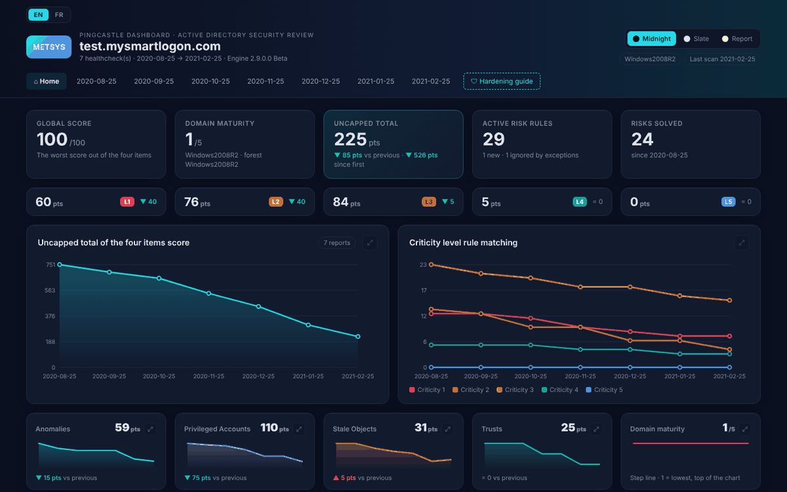
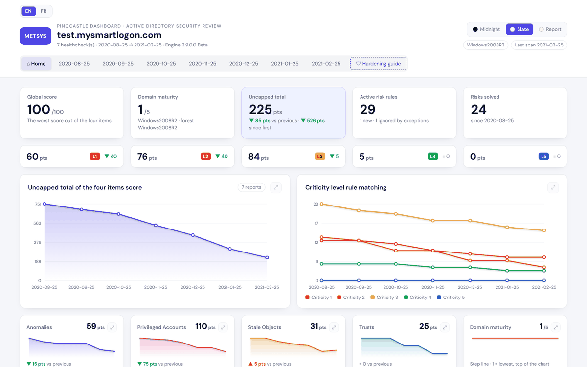
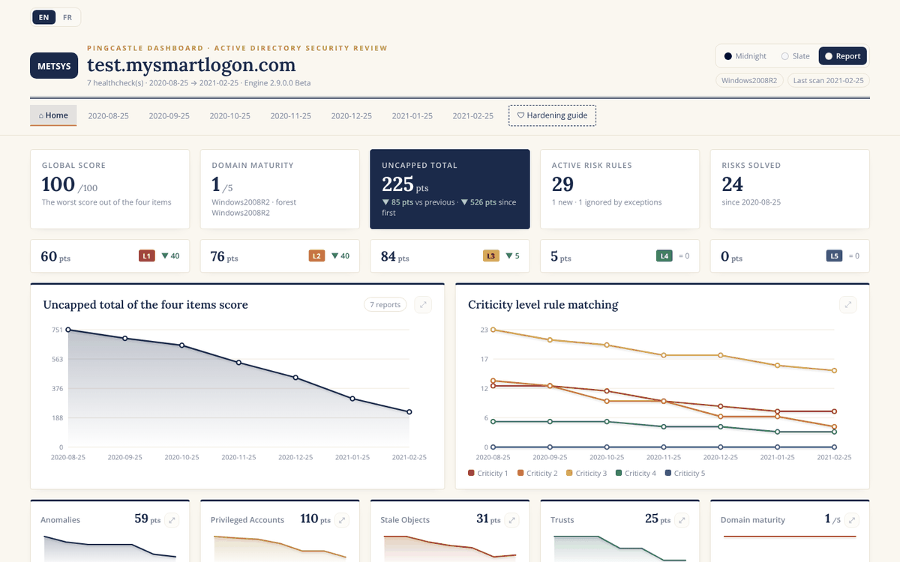
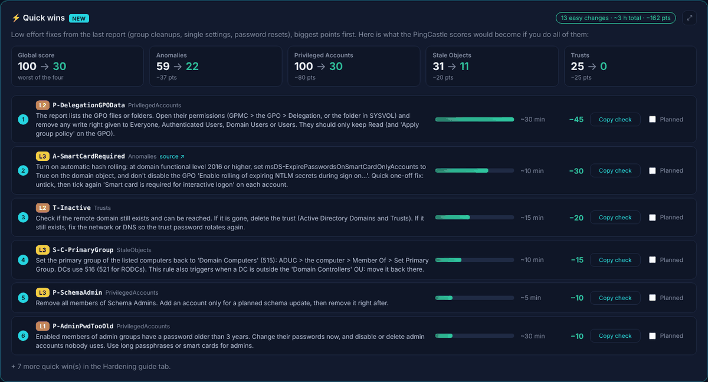
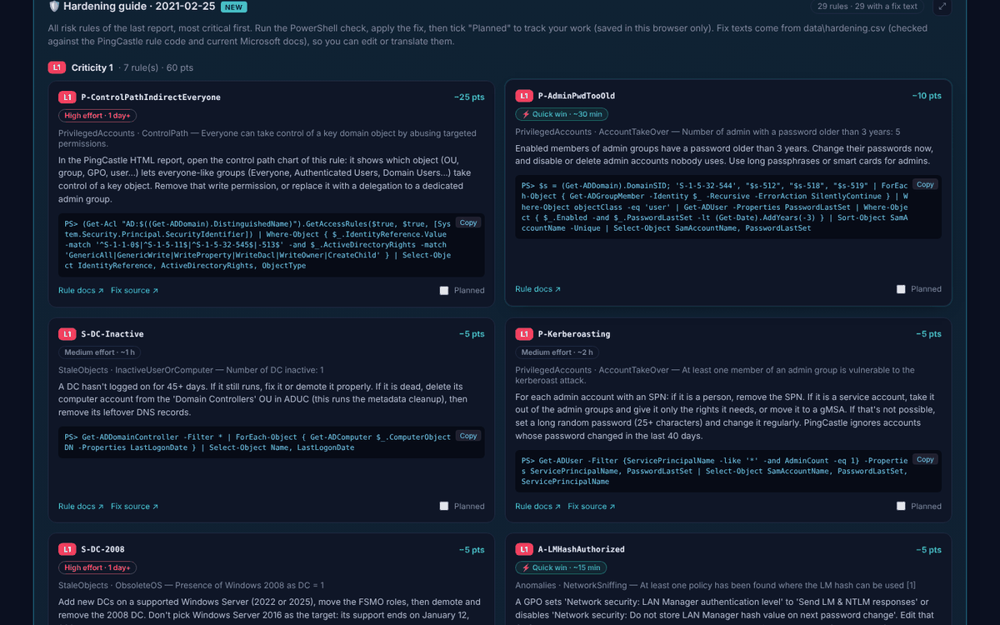
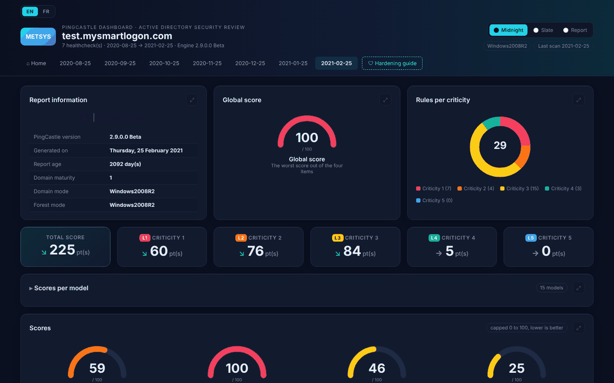
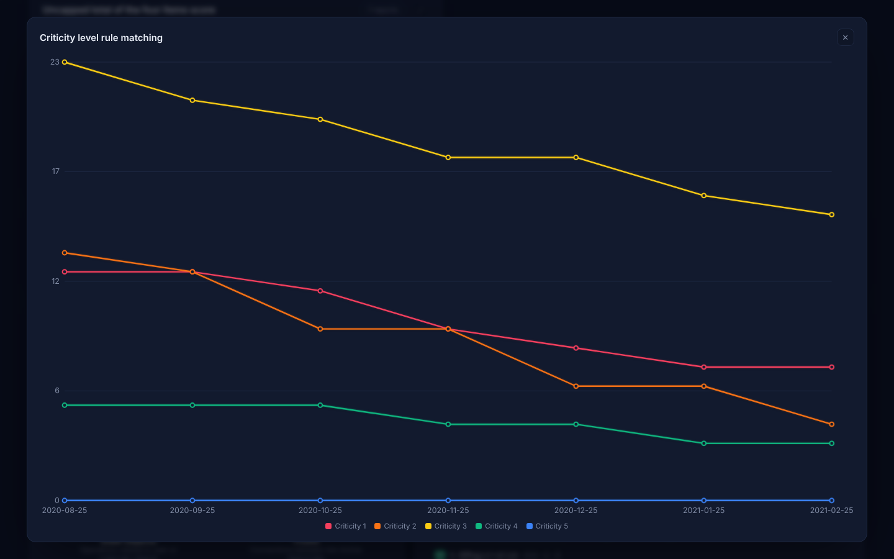
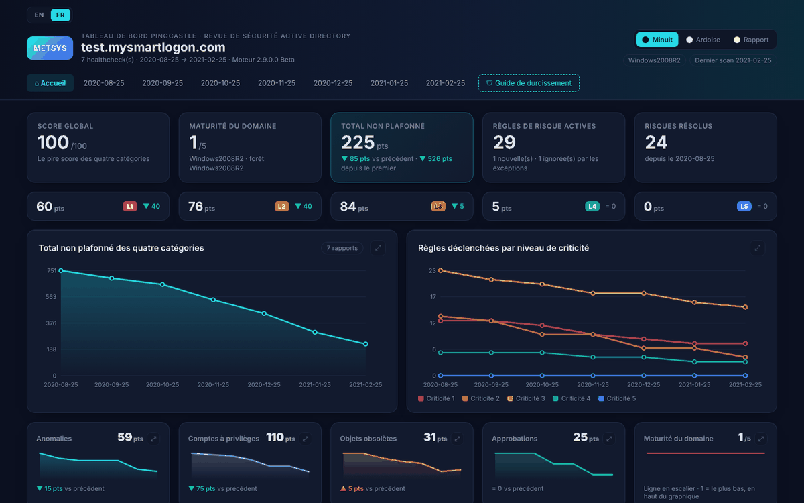

# PingCastleDashboard

Generates an HTML dashboard to review the evolution of PingCastle scores and metrics using the XML files generated by PingCastle.

> This fork by [k0r1m](https://github.com/karim852) adds a new themed design, AD hardening help, quick wins and a French version on top of the original project by [Léo Bouard](https://github.com/leobouard/PingCastleDashboard).



`PingCastleDashboard.ps1` now creates a self-contained themed dashboard and **no module is needed**. The original PSWriteHTML dashboard is still available with the `-Classic` switch (it requires the module `PSWriteHTML`: `Install-Module PSWriteHTML`). `PingCastleGlobalDashboard.ps1` still uses PSWriteHTML. More information about this module here: <https://github.com/EvotecIT/PSWriteHTML>

### Themes and AD hardening help

- 3 themes: **Midnight** (dark), **Slate** (light) and **Report** (client / print). Switch at the top right of the page; the choice is saved in the browser. Set the default with `-Theme Midnight|Slate|Report`.
- **English and French**: switch at the top left of the page (EN | FR); the choice is saved in the browser. Set the default with `-Language EN|FR`. PingCastle data (rule IDs, rationale, categories) stays as PingCastle writes it.
- **AD hardening plan** on the Home tab, a **How to fix** column in the risk rule tables, and a **Hardening guide** tab with a fix, a PowerShell check, a source link and a "Planned" checkbox for every rule of the last report.
- **Quick wins**: the low effort fixes that save the most points, with a time estimate and the PingCastle scores you would get after doing them.
- Fix texts live in `data\hardening.csv` (`RiskId;Fix;Check;Effort;Minutes;Ref;FixFR`), so you can edit, add or translate them. They were checked against the PingCastle rule code and current Microsoft docs. The checks use group SIDs, so they also work on non-English ADs.
- `tests\Test-HardeningChecks.ps1` runs every check of the CSV on a domain controller of a test domain and lists the ones that fail. All checks are read-only.
- Every panel can be expanded to full screen (⤢), charts redraw at their real size, and tables can be sorted, searched and exported to CSV.

| Midnight | Slate | Report |
| --- | --- | --- |
|  |  |  |

| Quick wins | Hardening guide |
| --- | --- |
|  |  |

| Report tab | Expanded chart | French version |
| --- | --- | --- |
|  |  |  |

```powershell
.\PingCastleDashboard.ps1 -XMLPath .\xml -Theme Report -Language FR
.\PingCastleDashboard.ps1 -XMLPath .\xml -Classic   # original PSWriteHTML dashboard
.\tests\Test-HardeningChecks.ps1                     # on a DC: run all hardening checks
```

## How to use it?

The project contains three scripts:

1. `PingCastleDashboard.ps1` to create one dashboard per domain
2. `PingCastleGlobalDashboard.ps1` to create a centralized dashboard for up to 10 domains
3. `UpdateHCRules.ps1` to update Ping Castle healthcheck rules

### PingCastleDashboard.ps1

You simply have to gather the XML files generated by PingCastle in one folder and execute the `PingCastleDashboard.ps1` script. One report will be generated for each domain.

[Dashboard example (original design)](https://www.labouabouate.fr/assets/files/dashboard_test.mysmartlogon.com)

New dashboard generated from the sample XML reports of the `xml` folder: [English](https://htmlpreview.github.io/?https://github.com/karim852/PingCastleDashboard/blob/main/examples/dashboard_test.mysmartlogon.com.html) · [Français](https://htmlpreview.github.io/?https://github.com/karim852/PingCastleDashboard/blob/main/examples/dashboard_test.mysmartlogon.com_fr.html) (files in the `examples` folder, you can also download them and open them in a browser).

### PingCastleGlobalDashboard.ps1

Same as the `PingCastleDashboard.ps1`, you gather the XML files in one folder and execute the `PingCastleGlobalDashboard.ps1` to create a centralized dashboard for up to 10 domains.

### UpdateHCRules.ps1

To add criticity scores to the healthcheck rules, the script uses the CSV file `HCRules.csv` which can be outdated. To update the file, you simply have to run the script `UpdateHCRules.ps1`. The script will parse the GitHub repository of the PingCastle project to get the latest healthcheck rules.

## Handle exceptions

In some cases, PingCastle can be a little blind or too severe. If you wish, you can add some risk rules to the `data\exceptions.csv` file to ignore them in the dashboard.

If you wish to add the exception to each domain, you can use the wildcard character (*) in the "Domain" column.

All ID risk rules are available in the `HCRules.csv` file if you need a complete repository.

## Links

- [netwrix/pingcastle: PingCastle - Get Active Directory Security at 80% in 20% of the time](https://github.com/netwrix/pingcastle)
- [EvotecIT/PSWriteHTML: PSWriteHTML is PowerShell Module to generate beautiful HTML reports, pages, emails without any knowledge of HTML, CSS or JavaScript. To get started basics PowerShell knowledge is required.](https://github.com/EvotecIT/PSWriteHTML)
- [Dashimo (PSWriteHTML) - Charting, Icons and few other changes - Evotec](https://evotec.xyz/dashimo-pswritehtml-charting-icons-and-few-other-changes/)
- [Dashimo - Easy Table Conditional Formatting and more - Evotec](https://evotec.xyz/dashimo-easy-table-conditional-formatting-and-more/)

## Special thanks

This project wouldn't be possible without the help and/or the work of colleagues from [METSYS](https://blog.metsys.fr), so thank you to:

- [Thierry PLANTIVE](https://www.linkedin.com/in/thierry-plantive-764b5b93/) for the original idea, feedbacks and features requests
- [stefan-frenchies](https://github.com/stefan-frenchies) for the XML parse code
- [Vincent VUCCINO](https://www.linkedin.com/in/vincent-vuccino-7948762b/) for the HCRule code
- [mgirardi23](https://github.com/mgirardi23) for the exceptions list
- [Patrick BOUDET](https://www.linkedin.com/in/patrick-boudet-74582b42/) and [Gunnar DHONDT](https://www.linkedin.com/in/gunnar-dhondt-5b1950168/) for the global dashboard
